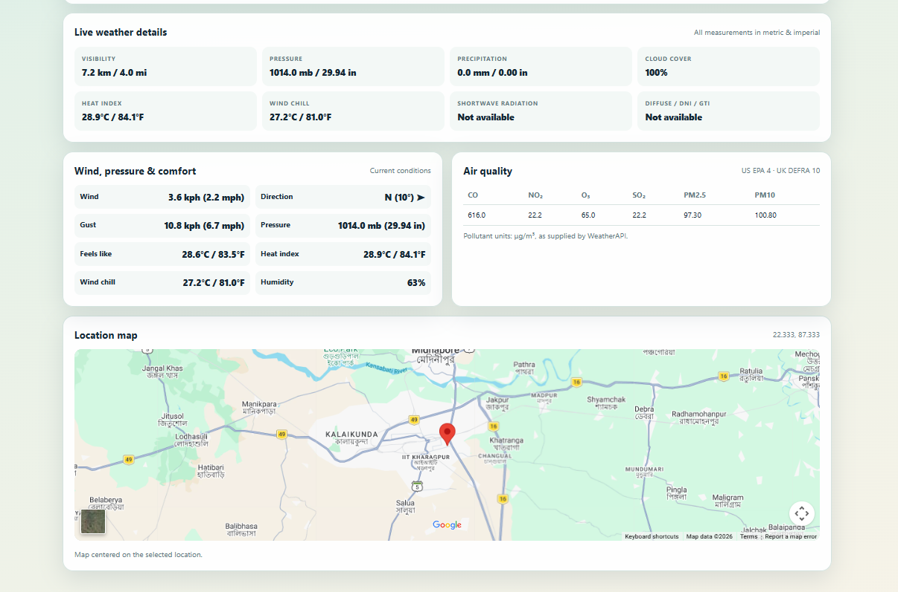

# Weather Orion  
*Forecasting Tomorrow, Today.*

A modern and lightweight **Weather Web App** built with **HTML, CSS, and JavaScript**, powered by the **[WeatherAPI](https://www.weatherapi.com/).**  
Weather Orion delivers real‑time weather information through a clean, responsive, and intuitive interface.

---

### ✨ Features
- Search weather by **city name** or **latitude/longitude**
- View detailed data: **temperature, conditions, humidity, wind, pressure, UV index**, and more
- Default weather cards for *Kolkata, New Delhi, and New York* on initial load
- **Responsive design** for seamless use across desktop and mobile devices
- Lightweight and fast performance with efficient API integration

---

### 🚀 Live Demo
[Weather Orion](https://parthajit3080.github.io/Weather-Orion/)

  


---

### 🛠️ Tech Stack
- **Frontend**: HTML, CSS, JavaScript  
- **API**: WeatherAPI  

---

### 🔧 Setup & Usage
1. **Clone this repository**
   ```bash
   git clone https://github.com/your-username/Weather-Orion.git
   cd Weather-Orion

### 📂 Project Structure
├── index.html       # Main HTML file
├── theme.css        # CSS styling
├── theme.js         # JavaScript logic
├── README.md        # Project documentation
├── WO1.png          # Screenshot 1 of the website
├── W02.png          # Screenshot 2 of the website


### 🙌 Acknowledgements

- Weather data powered by WeatherAPI
- Inspired by simple & clean weather app designs
